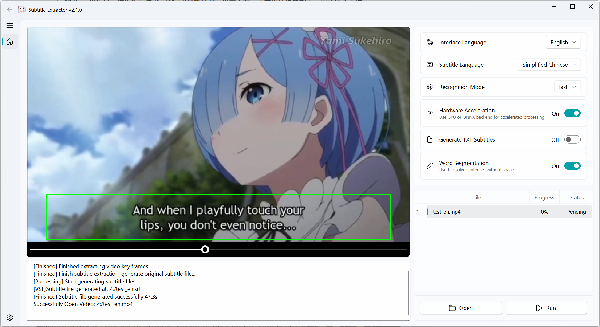

> This fork adds genuine PP-OCRv6 small/medium, VideoSubFinder CLI v6.10.7, light/dark/system themes and a noninteractive CLI. See the [current runtime guide](docs/USAGE.md) for installation, Docker and tests. Release/platform verification is tied to the exact commit's GitHub Actions results.

[简体中文](README.md) | English

<p align="center"></p>

## Introduction


Video-subtitle-extractor (VSE) is a software that extracts hard-coded subtitles from videos into external subtitle files (SRT format).

Key features:

- Extract key frames from videos
- Detect text positions in video frames
- Recognize text content in video frames
- Filter out non-subtitle text regions
- [Remove watermarks, channel logos, and original hard-coded subtitles — use with: video-subtitle-remover (VSR)](https://github.com/YaoFANGUK/video-subtitle-remover/tree/main)
- Remove duplicate subtitle lines and generate SRT subtitle files / TXT text files
- Support **batch extraction** of video subtitles
- Multi-language: supports subtitle extraction in **87 languages**, including **Simplified Chinese (Chinese-English bilingual)**, **Traditional Chinese**, **English**, **Japanese**, **Korean**, **Vietnamese**, **Arabic**, **French**, **German**, **Russian**, **Spanish**, **Portuguese**, **Italian**, and more
- Multiple modes:
  - **Fast**: (Recommended) Uses small models for v6-supported languages and the explicit compatibility recognizers for other languages.
  - **Auto**: Uses medium only with enabled, available Paddle CUDA; CPU, DirectML and Python/Native CoreML use small.
  - **Accurate**: Uses medium detection/applicable recognition models. Errors remain possible; speed depends on the backend, video and hardware.

> Please use Fast/Auto mode first. Only switch to Accurate mode if the first two modes miss too many subtitle lines.

<p style="text-align:center;"></p>

**Highlights**:

- Uses local OCR recognition — no need to configure any API or connect to online OCR services such as Baidu or Alibaba
- Supports explicit acceleration backends. Measure performance on the actual workload; changing to a GPU does not inherently improve accuracy for the same mode/model.

**Usage Guide**:

- For questions, please join the discussion group (QQ Group): 210150985 (full), 806152575 (full), 816881808 (full), 295894827

- Click [Open] to select video files, adjust the subtitle area, then click [Run]
  - Single file extraction: Select **one** video file when opening
  - **Batch extraction**: Select **multiple** video files when opening. Ensure all videos have the same resolution and subtitle area

- Remove watermark text / Replace specific text:
> If specific text appears in the video that needs to be removed or replaced, edit the ``backend/configs/typoMap.json`` file and add your replacements

```json
{
	"l'm": "I'm",
	"l just": "I just",
	"Let'sqo": "Let's go",
	"Iife": "life",
	"威筋": "威胁",
  	"性感荷官在线发牌": ""
}
```

> This will replace all occurrences of "威筋" with "威胁" and delete all "性感荷官在线发牌" text

- Spaces and Unicode in video paths are supported by the shell-free CLI and covered by regression tests.
- New CPU one-click packages include Python, curated inference libraries, models and VSF. Customers do not install Python or dependencies. Run `Start-VSE.bat` on Windows, open the `.app` on macOS, or run `Start-VSE.sh` on Linux. See [release instructions](docs/release-and-ci.md) for tested OS limits and validation status.

**Downloads**: [this fork's releases](https://github.com/eritpchy/video-subtitle-extractor/releases). Historical assets do not certify the new PP-OCRv6 changes; check the exact release commit and completed CI.

**Recognition modes**:
- Fast: PP-OCRv6 small for supported languages, VideoSubFinder frame detection.
- Auto: medium only with enabled, available Paddle CUDA; small on CPU, DirectML and CoreML.
- Accurate: medium models; CPU/CoreML retain VideoSubFinder detection, while Paddle CUDA/DirectML can use frame-by-frame detection.
- Unsupported v6 languages retain explicit v5/v3 language recognizers. See [model coverage](docs/PP-OCRv6.md).

Source backends include default Paddle, Windows DirectML and macOS Python CoreML. Native one-click package implementations are separate from source installation. Backend availability is not hardware certification: consult completed CI for the exact commit.

## Demo

- GUI version: [Click to view GPU version source code installation tutorial](https://www.bilibili.com/video/bv11L4y1Y7Tj)

<p style="text-align:center;"></p>


## Source Code Usage Guide

**The application can run from Python source without compiling or invoking this project's C++ `native-ocr` worker.**
The repository includes GUI/CLI, video orchestration and Python Paddle, DirectML and CoreML OCR adapters and processing.
The C++ worker under `native/ocr/` is a separate one-click package implementation, not a source-run prerequisite.
This does **not** mean every dependency is pure Python: Qt/PySide, Paddle, ONNX Runtime, OpenCV, FFmpeg and
VideoSubFinder include native third-party binaries. Install their supported platform distributions.

### 1. Clean clone and Python environment

Use **Python 3.12**, not an arbitrary “3.12+”. Create a separate environment for each backend;
do not mix CPU/GPU Paddle packages or different ONNX Runtime distributions.

```sh
git clone https://github.com/eritpchy/video-subtitle-extractor.git
cd video-subtitle-extractor
python3.12 -m venv .venv
. .venv/bin/activate
```

On Windows PowerShell, replace the last two lines with:

```powershell
py -3.12 -m venv .venv
.venv\Scripts\Activate.ps1
```

### macOS GUI Qt preparation boundary

This candidate requires **macOS arm64 26.0+**, based on the highest actual minimum
of its native libraries. Qt/PySide is fixed to 6.12.0. The reviewed Cocoa fix is a
single-plugin candidate overlay; a GUI startup is not external accessibility acceptance.
All macOS source backends share this preparation, without this project's C++ worker or a compiler.

Install the selected requirements in your own venv, optionally adding the explicit
`-c requirements-macos-qt.txt` constraint. Close GUI processes using that venv and run
`python scripts/prepare_macos_qt.py` for read-only inspection first.
**Public repair resources are not published yet and production admission remains blocked.**
Authorized candidate tests explicitly supply the exact reviewed local resource:

```sh
python scripts/prepare_macos_qt.py --apply --candidate-testing --archive /absolute/path/vse-qt6.12.0-macos-arm64-ax772484-ps6.zip
```

Only one plugin in this isolated venv is changed, with original wheel RECORDs,
licenses, corresponding source and a separate receipt preserved. System packages
are never patched. The fixed public-download `--apply` path is enabled only after
resource publication and complete acceptance. See the [Qt resource and acceptance boundary](docs/audits/macos-qt-overlay.md).

### 2. Default Paddle Python path (CPU)

```sh
python -m pip install -r requirements.txt
python -m pip check
python scripts/install_videosubfinder.py --version 6.10.7
python -S scripts/prepare_source_models.py paddle --output build/source-paddle-models --cache build/model-downloads/paddle
python -S scripts/prepare_source_models.py verify --format paddle build/source-paddle-models
```

This prepares **all 15 pinned original models**: four v6 small/medium detection/recognition models,
ten v5 compatibility recognizers and one v3 Kannada recognizer—not only the four v6 models.
The output must be a new directory; tracked checkout models are not overwritten. Select the separate data root:

```sh
export VSE_OCR_BACKEND=paddle
export VSE_MODEL_DIR="$PWD/build/source-paddle-models"
python gui.py
# Or:
python -m backend.cli "input.mp4" --language en --mode fast --cpu
```

Equivalent PowerShell environment syntax:

```powershell
$env:VSE_OCR_BACKEND = 'paddle'
$env:VSE_MODEL_DIR = "$PWD/build/source-paddle-models"
python gui.py
```

### 3. Windows Python CUDA 11.8 / 12.6 source paths

In a fresh Windows x64 / Python 3.12 environment, choose
`requirements-source-cuda118.txt` **or** `requirements-source-cuda126.txt`.
Do not co-install CPU Paddle or the other CUDA variant. These paths use full
PySide6 and ordinary pip, not this project's C++ worker. A compatible NVIDIA
system driver is still required; CUDA wheels/libraries do not supply that driver.
See the [complete Windows CUDA source commands](docs/USAGE.md#windows-python-cuda-118-or-126-source-backend)
for environment creation, installation, `pip check`, device discovery, all 15 models and CLI use.
Existing Windows Server package checks used explicit CPU inference; they do not
certify these new source-install recipes or real CUDA hardware execution.
CUDA 10.2 remains an old 2.2.0 download, not current Python 3.12/Paddle 3.3.1 source support.

### 4. DirectML / Python CoreML source paths

Choose one in another clean Python 3.12 environment:

| Platform/backend | Requirements | Backend variable | Model-root variable |
| --- | --- | --- | --- |
| Windows DirectML | `requirements-directml-inference.txt` | `VSE_OCR_BACKEND=directml` | `VSE_DIRECTML_MODEL_ROOT` |
| macOS arm64 Python CoreML | `requirements-coreml-inference.txt` | `VSE_OCR_BACKEND=python-coreml` | `VSE_PYTHON_COREML_MODEL_ROOT` |

After installing the selected requirements and VSF, prepare the shared complete FP32 ONNX data:

```sh
python -S scripts/prepare_source_models.py onnx --output build/source-onnx-models --cache build/model-downloads/onnx
python -S scripts/prepare_source_models.py verify --format onnx build/source-onnx-models
```

The source is a public, SHA256-pinned official 2.3.0 release ZIP. The helper extracts **only 15 graphs,
13 configs and two model metadata files**. It never extracts, installs or executes the Linux worker/runtime.
No GitHub login, Actions token, C++ compiler or local model converter is needed. To reuse the original ZIP,
pass `--archive PATH --offline` instead of downloading it.

For example, on macOS (see the [runtime guide](docs/USAGE.md) for Windows DirectML commands):

```sh
export VSE_OCR_BACKEND=python-coreml
export VSE_PYTHON_COREML_MODEL_ROOT="$PWD/build/source-onnx-models"
python gui.py
# Explicit CPU through this same Python backend:
python -m backend.cli "input.mp4" --language en --mode accurate --cpu
```

Provider registration, model hashes and earlier Native worker results do not establish successful inference
through this Python backend. CoreML EP execution is not proof of physical GPU dispatch or internal precision.
See [source, offline and reproducible conversion details](docs/USAGE.md).

## FAQ

#### 1. Program not working / no results / CUDA and cuDNN issues

Start with the CPU setup above. Check `python -m pip check`, model verification, the VSF installer verification and the extraction log. An OCR error now returns a nonzero exit status rather than a successful empty result.

#### 2. 7z file extraction error

Solution: Upgrade 7-Zip to the latest version.

## Sponsor

